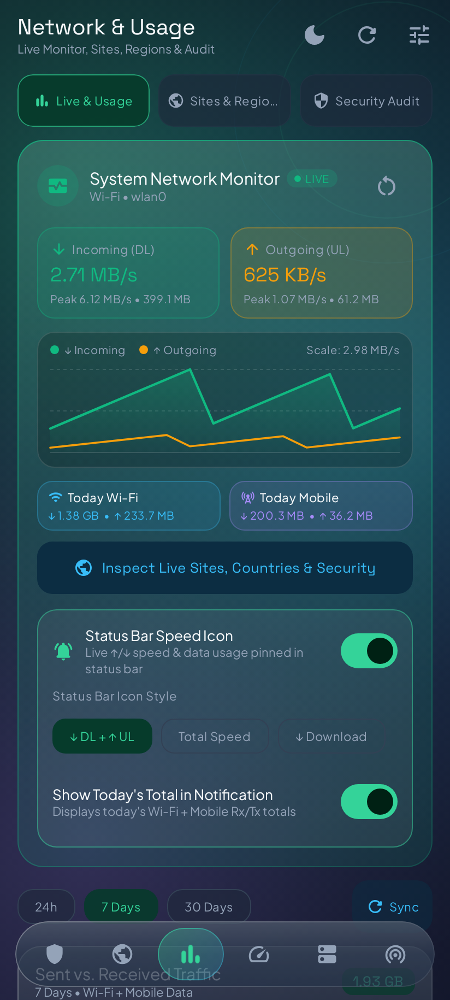

<p align="center">
  
</p>

<h1 align="center">NetGate</h1>

<p align="center">
  <b>Root-free Android firewall, ad &amp; tracker blocker, DNS filter, DPI bypass shield, hotspot proxy and live network monitor.</b>
</p>

NetGate runs entirely on the device. It uses Android's local `VpnService`, a userspace DNS resolver and local HTTP/HTTPS proxies to enforce per-app Wi-Fi and mobile-data rules, block ads and unwanted domains, bypass ISP deep packet inspection without root, keep tethered clients filtered, and show what the network is actually doing.

## Core features

### Per-app firewall
- Block or allow **Wi-Fi** and **mobile data** independently for every installed app, with no root and no remote VPN server.
- Batch actions (`Block Wi-Fi`, `Block Data`, `Block Both`, `Allow All`), search, and filters by network state, system apps, or apps without internet permission.
- Optional **auto-disable countdown timers** that cut an app's network access after a preset or custom duration.

### Ad, tracker and website blocking
- System-wide **ad and tracker blocking** through 10+ built-in hosts/Adblock lists (StevenBlack, AdGuard DNS, OISD, HaGeZi and more), custom lists, exception rules, and essential OS/push passthrough.
- **Domain blocking** in Blocklist mode or a **whitelist-only lockdown**, with per-app bypass and live DNS query logs.
- **SafeSearch** enforcement across Google, Bing, DuckDuckGo and Brave, plus **YouTube Restricted Mode** (Moderate/Strict) and YouTube ad-endpoint blocking.

### DPI bypass shield (no root)
- Defeats ISP **SNI and HTTP deep packet inspection** on the device with **Autopilot** (learns and escalates working strategies per domain), **SNI Split** (fragments the TLS `ClientHello` across the SNI midpoint), **Micro Chunks**, and **HTTP Desync**.
- **QUIC downgrade** (`UDP/443` blocking and DNS `SVCB`/`HTTPS` `QTYPE 65` stripping) so filtered traffic stays on TCP.
- **DNS over TCP**, `DoH + DoTCP`, and **anti-DNS-poisoning** validation, with live bypass, poison and QUIC counters.

### DNS control and diagnostics
- Choose Cloudflare (`1.1.1.1`, `1.1.1.2`, `1.1.1.3`), AdGuard, Quad9, Google, or a custom **DoH/UDP** resolver, with selectable transport (`DoH`, `DoTCP`, `UDP + DoTCP`).
- **DNS check** shows the resolver and exit server actually in use, and a **DNS leak test** verifies queries are not escaping the filter.

### Hotspot proxy and Wi-Fi automation
- Share NetGate's ad, website and SafeSearch rules with tethered devices through a LAN **HTTP/HTTPS proxy** on the Hotspot interface (custom port supported), or relay tethered traffic through an active external VPN.
- Per-device speed and usage tracking, device nicknames, one-tap client blocking and per-device **data caps**.
- **Global Wi-Fi lock**, scheduled Wi-Fi cut-off countdowns, and **auto-lock when idle** when throughput stays below a threshold.

### Live network monitor and history
- Real-time system-wide download/upload speed with peak and session totals, plus a live throughput chart.
- Today's **Wi-Fi and mobile** traffic at a glance, and an optional **status bar speed readout**.
- **Sites, regions and security audit:** see contacted domains and IPs grouped by country (GeoIP), inspect live sockets, and scan for suspicious connections or risky accessibility/admin hooks.

### WireGuard and WARP VPN Guard
- Import or generate **WireGuard** profiles and **Cloudflare WARP** configurations, connect from the app, and watch tunnel status and live telemetry alongside firewall state.

## Screenshots

| Per-app firewall | Ad &amp; website blocker |
| --- | --- |
|  |  |

| Network monitor &amp; usage | DNS &amp; security |
| --- | --- |
|  |  |

## Download

Grab the signed APK from the [latest release](https://github.com/RanaGzzz/NetGate/releases/latest) — download **`netgate-release-3.5.apk`** under **Assets**.

Requirements: Android 7.0 (API 24) or newer. NetGate uses a local VPN, so Android allows only one active VPN at a time.

## Install

1. Download the APK to the device.
2. Allow installation from the browser or file manager when prompted.
3. Open NetGate, turn on the firewall, and accept Android's VPN consent dialog.
4. If you enable DNS/ad/website filtering or DPI bypass, keep Android **Private DNS** set to **Automatic** or **Off** so queries reach NetGate's local filter.

## Build from source

Requirements:

- JDK 21
- Android SDK with platform **API 36.1** and build-tools 36.0.0
- `local.properties` pointing at your SDK (`sdk.dir=...`)

Build a debug APK:

```shell
./gradlew :app:assembleDebug
```

ABI splits are enabled, so each build emits one APK per architecture plus a universal APK. The universal debug APK is written to `app/build/outputs/apk/debug/app-universal-debug.apk`. Install it with:

```shell
adb install -r app/build/outputs/apk/debug/app-universal-debug.apk
```

To test the smaller per-ABI build instead, install `app/build/outputs/apk/debug/app-<abi>-debug.apk` (for example `app-arm64-v8a-debug.apk`).

Run the unit and Robolectric test suite:

```shell
./gradlew :app:testDebugUnitTest
```

Release builds use the keystore configured in `app/build.gradle.kts`; supply `STORE_PASSWORD` and `KEY_PASSWORD` in the environment and run `./gradlew :app:assembleRelease`. Pushing a version tag (e.g. `v3.5`) triggers the GitHub Actions release workflow to run tests, sign one APK per ABI plus a universal APK using repository secrets (`KEYSTORE_BASE64`, `STORE_PASSWORD`, `KEY_PASSWORD`), extract release notes from `CHANGELOG.md`, and publish the GitHub Release. Release assets are named `netgate-release-<version>-<abi>.apk` (smaller, architecture-specific) and `netgate-release-<version>.apk` (universal, installs anywhere); each has a `.sha256` alongside it.

### Beta releases

A version with a pre-release suffix publishes a GitHub prerelease instead of a full release, so testers can install it while the stable channel keeps pointing at the last full release. To cut one:

1. Set `versionName` to the beta version (for example `3.6-beta.1`) and bump `versionCode` in `app/build.gradle.kts`.
2. Add a matching `# What's New — NetGate 3.6-beta.1` section to `CHANGELOG.md`.
3. Tag the commit on the default branch with `v3.6-beta.1`.

The tag must still equal `versionName` exactly. Because a beta carries its own `versionCode`, the next stable release must use a higher one.

## How it works

- **Per-app firewall:** `NetGateVpnService` applies per-app rules for the active transport, `TunPacketInspector` rejects unauthorized packets, and global Wi-Fi lock plus UID checks prevent bypasses without root.
- **DNS, SafeSearch and filtering:** IPv4/IPv6 UDP/53 queries are intercepted; browser DoH discovery is blocked; QUIC hints are stripped when DPI bypass is active; poisoned private/bogon answers are rejected; SafeSearch and YouTube restricted domains are rewritten; allowed queries are forwarded over DoH, DNS-over-TCP, or protected UDP sockets.
- **HTTPS/SNI and DPI bypass:** `LocalFilteringProxyServer` and `DpiBypassEngine` run on `127.0.0.1`, enforcing host/SNI rules, stripping tracking parameters (`utm_*`, `fbclid`, `gclid`), optionally chaining to an upstream proxy, and reshaping outbound TLS `ClientHello` / HTTP `Host` headers in userspace.
- **Hotspot proxy and automation:** `HotspotProxyService` binds an HTTP/HTTPS proxy on the detected Hotspot interface for per-client caps, blocking and filters, while `AlarmManager` and throughput checks power scheduled and idle Wi-Fi locks.
- **Home screen widget, recents privacy & updates:** `NetGateWidgetProvider` exposes 1-tap home screen toggles for VPN, DPI Bypass, Ad Blocker, and Hotspot Proxy; Settings adds Exclude from Recents, GitHub Release update checking, changelog browsing, and passive VPN/DPI logs.
- **Persistence:** Room stores per-app rules, timers, filter lists, website rules, traffic snapshots, daily history and site/region logs; Jetpack DataStore stores DNS, DPI bypass, proxy, Hotspot, UI and privacy preferences.

## Permissions

| Permission / declaration | Purpose |
| --- | --- |
| `BIND_VPN_SERVICE` | Runs the local firewall, DNS filter, ad/website blocker and Wi-Fi traffic lock |
| `INTERNET` | Speed tests, DoH/DoTCP forwarding, filter list sync, hotspot relay, GitHub update checks and GeoIP lookups |
| `ACCESS_NETWORK_STATE` | Detects active Wi-Fi vs. mobile data, DNS servers, external VPN tunnels and Private DNS state |
| `ACCESS_WIFI_STATE` | Reads Wi-Fi link telemetry and hotspot interface state |
| `PACKAGE_USAGE_STATS` *(optional)* | Reads per-app and OS tethering traffic totals |
| `FOREGROUND_SERVICE`, `FOREGROUND_SERVICE_SPECIAL_USE` | Keeps filtering, timers, live speed icon and the hotspot proxy alive in the background |
| `POST_NOTIFICATIONS` *(optional)* | Shows firewall, hotspot and live status bar speed readout notifications |
| `REQUEST_IGNORE_BATTERY_OPTIMIZATIONS` *(optional)* | Lets users exempt NetGate from Battery Saver restrictions so background VPN and speed icon stay active |
| `<queries>` launcher intent | Enumerates installed apps for per-app rules |

## Technology

- **Language & UI:** Kotlin, Jetpack Compose, Material 3, custom Canvas charts
- **Architecture:** MVVM, repository pattern, coroutines, `StateFlow`
- **Storage:** Room, Jetpack DataStore
- **Networking & system:** Android `VpnService`, local `ServerSocket` SNI/hotspot proxies, `ConnectivityManager`, `NetworkStatsManager`, `TrafficStats`, `WifiManager`, `AlarmManager`
