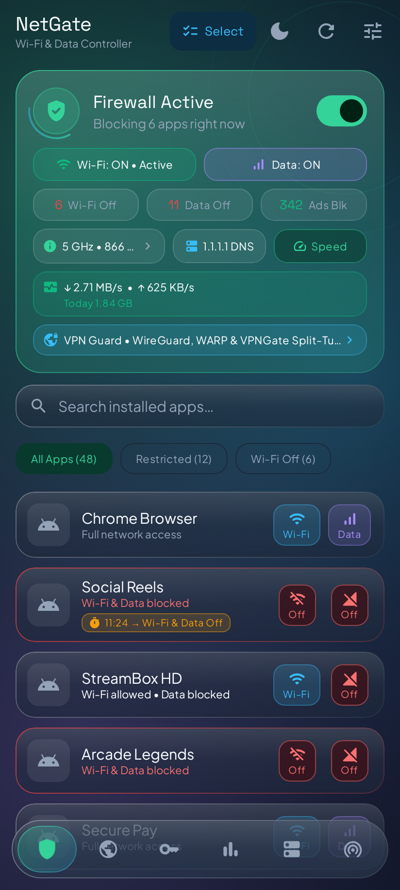
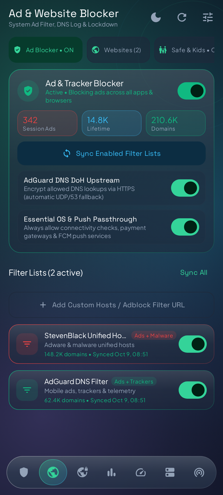
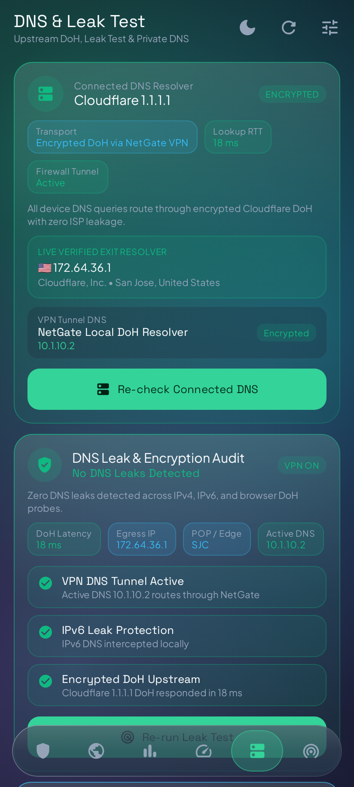

# NetGate

**A root-free Android firewall, system-wide ad blocker, DNS filter, DPI bypass shield, hotspot proxy, and live network monitor.**

NetGate uses Android's local `VpnService` and on-device userspace proxies to enforce per-app Wi-Fi/mobile data rules, block ads and unwanted domains, bypass ISP SNI/HTTP deep packet inspection without root, enforce SafeSearch and YouTube Restricted Mode, share filtered or VPN-routed connections over Hotspot with per-device controls, inspect live site/country traffic, check active DNS & DNS leaks, and display real-time upload/download speeds in the status bar.

## Features

- **Per-app firewall:** Independently block or allow Wi-Fi and mobile data per app without root, apply batch rules (`Block Wi-Fi`, `Block Data`, `Block Both`, `Allow All`), and filter apps by network status.
- **Auto-disable countdown timers:** Schedule any app's Wi-Fi, mobile data, or both to automatically cut off after a preset or custom duration.
- **Tabbed Ad & Website Blocker:** Cleanly separated **Ad Blocker**, **Websites**, **Safe & Kids**, **SNI & DPI**, and **DNS Logs** tabs for distraction-free rule management.
- **System-wide ad & tracker blocker:** Sync 10+ built-in hosts/Adblock filter lists (StevenBlack, AdGuard DNS, OISD, HaGeZi, etc.) or add custom lists, with exception rules and essential OS/push passthrough.
- **Website blocker & lockdown mode:** Block domains and subdomains via Blocklist mode or switch to Whitelist-Only lockdown, with per-app bypass support and live DNS query logs.
- **SafeSearch, YouTube Restricted Mode & YouTube ad blocking:** Enforce SafeSearch across Google, Bing, DuckDuckGo, and Brave Search, apply Moderate/Strict YouTube Restricted Mode for kid-safe filtering, and block YouTube ad endpoints.
- **DPI Bypass Shield (No Root):** Bypass ISP SNI and HTTP deep packet inspection directly on-device using **Autopilot** (auto-learns and escalates failing domains), **SNI Split** (fragments TLS `ClientHello` across the SNI midpoint), **Micro Chunks**, or **HTTP Desync**, paired with QUIC (`UDP/443` & DNS `QTYPE 65`) downgrade, **DNS over TCP**, and **Anti-DNS Poisoning**.
- **Local HTTPS / SNI proxy with presets:** Inspect HTTP/TLS SNI hostnames locally on `127.0.0.1`, strip tracking query parameters (`utm_*`, `fbclid`, `gclid`), and switch between **Standard Direct**, **Ad & YouTube SNI**, **Family & Kids Safe**, **Strict Privacy Guard**, or a custom upstream SNI proxy.
- **Hotspot Proxy Sharing & per-device controls:** Run a LAN HTTP/HTTPS relay proxy on your Hotspot interface (`0.0.0.0:8890`, `:8080`, `:3128`, or custom port) to share NetGate's ad/website/SafeSearch rules—or route tethered traffic through an active third-party VPN—with live per-IP speed/usage tracking, custom device nicknames, 1-tap client blocking, and per-device data caps.
- **Global Wi-Fi Lock & automation:** Pause all device Wi-Fi app traffic in one tap without root, set **Disable Wi-Fi on Timer** countdowns (`5m`–`1h` or custom), or enable **Auto-Lock When Idle** when throughput stays below `2 KB/s`, with quick **Wi-Fi Panel** notifications.
- **Live speed monitor & status bar icon:** Track real-time system-wide upload/download speeds and daily Wi-Fi/mobile totals (`Rx`/`Tx`), pinned directly to the Android status bar.
- **Sites, regions & security audit:** View which domains and IP addresses your device is sending/receiving data to, grouped by country/region (`GeoIP`), inspect live sockets, and scan for suspicious connections or risky accessibility/admin hooks.
- **DNS check, DoH & DNS leak test:** Verify which DNS resolver and exit server your device is actually using, switch between Cloudflare (`1.1.1.1`, `1.1.1.2`, `1.1.1.3`), AdGuard, Quad9, Google, or custom DoH/UDP servers, choose DNS transport modes (`DoH + DoTCP`, `DNS over TCP`, `UDP + DoTCP`), and run live DNS leak diagnostics.
- **Blur Engine UI & startup animation:** Hardware-accelerated `RenderEffect` acrylic glass surfaces (`Off`, `Soft Glass`, `Acrylic`, `Ultra Frost`), Day/Night/Dynamic Color theming, modal depth blur, smooth spring transitions, and an animated startup shield intro.

## Screenshots

| Firewall | Ad & website blocker |
|---|---|
|  |  |

| Network monitor | DNS & security |
|---|---|
|  |  |

## Download APK

Download `app-debug.apk` from the [NetGate Releases page](https://github.com/RanaGzzz/NetGate/releases). Open a release and select **app-debug.apk** under **Assets**.

The APK is a debug build for testing, not a Play Store release.

## Build locally

Install Git, JDK 21, Gradle 9.3.1, and the Android SDK platform used by this project (API 36, extension 1). The repository does not include a Gradle wrapper.

Clone the repository and enter its directory:

```shell
git clone https://github.com/RanaGzzz/NetGate.git
cd NetGate
```

If you don't already have a local `.env`, create one from the example. Add any required local secrets there; do not commit `.env`.

```powershell
if (-not (Test-Path .env)) { Copy-Item .env.example .env }
```

On macOS or Linux, use `test -f .env || cp .env.example .env`.

Create the debug signing key once per checkout. Keep this key for subsequent local builds if you want to install new builds over earlier ones.

```shell
keytool -genkeypair -v -keystore debug.keystore -storepass android -keypass android -alias androiddebugkey -keyalg RSA -keysize 2048 -validity 10000 -dname "CN=Android Debug,O=Android,C=US"
```

Build the debug APK:

```shell
gradle assembleDebug
```

Run the Robolectric unit test suite:

```shell
gradle :app:testDebugUnitTest
```

The APK is written to `app/build/outputs/apk/debug/app-debug.apk`. To install it on a connected Android device with `adb` available, run:

```shell
adb install -r app/build/outputs/apk/debug/app-debug.apk
```

## How it works

- **Per-app firewall & TUN inspector:** Uses Android's local `VpnService` (`NetGateVpnService`) to enforce per-app rules for the active network transport (`Wi-Fi` or `Mobile Data`), block unauthorized packets via `TunPacketInspector`, apply Global Wi-Fi Traffic Lock, and guard against UID bypasses without root.
- **DNS, SafeSearch & anti-censorship filtering:** Intercepts IPv4 and IPv6 UDP/53 DNS queries, blocks browser DoH discovery (`use-application-dns.net`, `_dns.resolver.arpa`), downgrades QUIC `SVCB`/`HTTPS` (`QTYPE 65`) records when DPI bypass is active, rejects poisoned private/bogon responses, rewrites SafeSearch/YouTube restricted domains cleanly, and forwards allowed queries over encrypted DoH, DNS-over-TCP, or protected UDP sockets (`protect()`).
- **HTTPS / SNI & DPI Bypass (`LocalFilteringProxyServer` & `DpiBypassEngine`):** Runs locally on `127.0.0.1` to enforce SNI/host rules, strip tracking parameters, optionally chain to a custom upstream proxy, and reshape outbound TLS `ClientHello` / HTTP `Host` headers in userspace without root or remote VPN servers.
- **Hotspot proxy & Wi-Fi automation (`HotspotProxyService` & `WifiAutomationManager`):** Binds an HTTP/HTTPS proxy on detected Hotspot interfaces to enforce per-client caps, blocking, and NetGate filter rules (or relay through an active external VPN), while `AlarmManager` and live throughput checks power scheduled and idle Wi-Fi locks.
- **Persistence:** Room stores per-app network rules, timers, ad filter lists, website rules, traffic snapshots, daily history, and site/region connection logs; Jetpack DataStore stores theme, Blur Engine, DNS, DPI bypass, proxy, Hotspot, and Wi-Fi automation preferences.

> **Private DNS note:** Android allows one active `VpnService` at a time. When DNS/ad/website filtering or DPI bypass is enabled, keep Android **Private DNS** set to **Automatic** or **Off** so DNS queries pass through NetGate's local filter.

## Permissions

| Permission / declaration | Purpose |
|---|---|
| `BIND_VPN_SERVICE` | Runs the local per-app firewall, DNS filter, ad/website blocker, and Wi-Fi traffic lock |
| `INTERNET` | Supports speed tests, DNS-over-HTTPS/TCP forwarding, filter list sync, Hotspot proxy relay, and GeoIP lookups |
| `ACCESS_NETWORK_STATE` | Detects active Wi-Fi vs. Mobile Data networks, DNS servers, external VPN tunnels, and Private DNS status |
| `ACCESS_WIFI_STATE` | Reads Wi-Fi link speed, band, frequency, signal telemetry, and Hotspot interface state |
| `PACKAGE_USAGE_STATS` *(optional)* | Reads per-app `Rx`/`Tx` network usage and OS tethering totals from `NetworkStatsManager` |
| `FOREGROUND_SERVICE` and `FOREGROUND_SERVICE_SPECIAL_USE` | Keeps firewall rules, timers, Hotspot proxy, and the status bar speed icon active in the background |
| `POST_NOTIFICATIONS` *(optional)* | Displays active firewall/Hotspot notifications, Wi-Fi lock panel actions, and the live status bar speed icon |
| `<queries>` for launcher apps | Enumerates installed user and system apps for per-app firewall control |

## Technology

- **Language & UI:** Kotlin, Jetpack Compose, Material 3, custom Canvas charts, hardware `RenderEffect` Blur Engine
- **Architecture:** MVVM, Repository pattern, Kotlin Coroutines, `StateFlow`
- **Storage:** Room Database, Jetpack DataStore Preferences
- **Networking & System:** Android `VpnService`, local `ServerSocket` SNI/Hotspot proxies, `ConnectivityManager`, `NetworkStatsManager`, `TrafficStats`, `WifiManager`, `AlarmManager`
